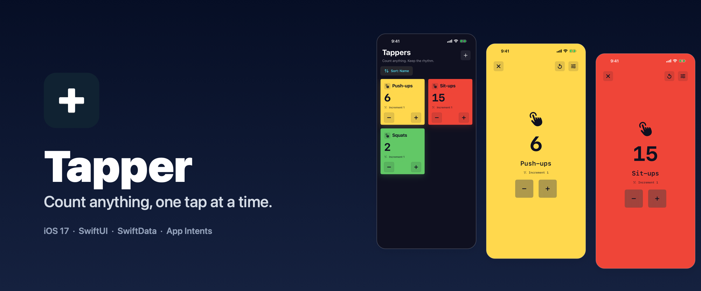
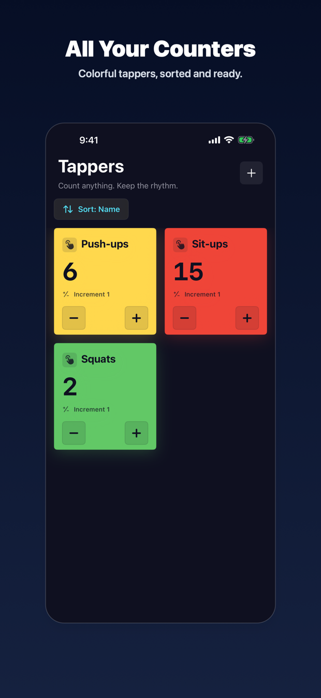
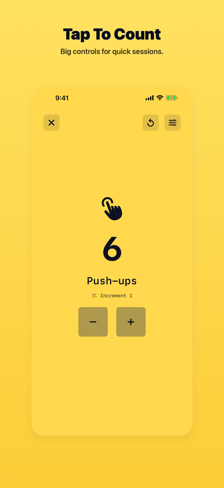
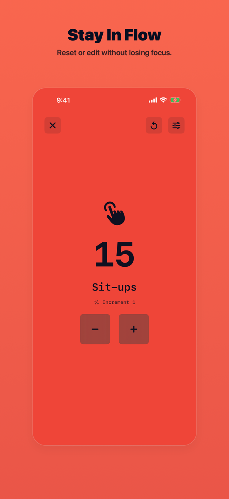
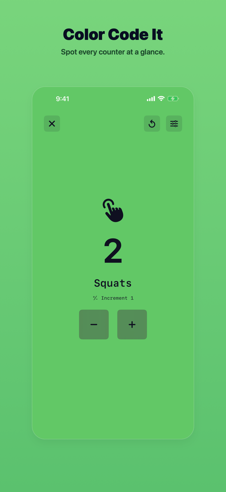

<p align="center">
  
</p>

<p align="center">
  <a href="https://github.com/JCTec/Tapper/actions/workflows/ci.yml"></a>
  
  
  
  <a href="LICENSE"></a>
</p>

# Tapper

A sleek, customizable tap-to-count app for tracking reps, laps, inventory, or
anything else worth tallying. Create as many counters as you like, give each one
its own colour and increment, and tap.

Tapper is a native iPhone and iPad app built entirely with SwiftUI and
SwiftData. It stores everything on-device, has no account, and collects no
personal data.

> Published on the App Store as **Tapper Counters**. *Tapper* is the home-screen
> display name and the name of this repository — see
> [docs/APP_STORE.md](docs/APP_STORE.md).

---

## Features

|  |  |
| :---: | :---: |
|  |  |
| **All Your Counters**<br>A searchable, sortable grid of every tapper you've made. | **Tap To Count**<br>Full-screen controls sized for fast, repeated taps. |
|  |  |
| **Stay In Flow**<br>Reset or edit a counter without leaving the session. | **Color Code It**<br>Pick a colour per counter and spot it at a glance. |

Beyond the headline features:

- **Custom increments** — step by 1, 5, 25, or whatever suits the task.
- **Optional negative values** — allow counting below zero per counter.
- **Automatic contrast** — label colour is derived at runtime from each
  counter's background so text stays legible on any colour.
- **Siri and Shortcuts** — "Open Tapper" and "Start counting with Tapper" are
  wired up through App Intents.
- **Accessible by construction** — Dynamic Type, monospaced digits, and
  accessibility identifiers throughout.

## Getting started

**Requirements:** Xcode 16 or newer, iOS 17.0+ deployment target, macOS with
Ruby and Bundler for the automation lanes.

```sh
git clone https://github.com/JCTec/Tapper.git
cd Tapper
open Tapper.xcodeproj
```

Swift Package Manager resolves the single dependency
([ColorKit](https://github.com/Boris-Em/ColorKit)) on first build. Select the
`Tapper` scheme and run.

For the fastlane lanes:

```sh
bundle install
bundle exec fastlane lanes   # list everything available
```

## Testing

```sh
bundle exec fastlane test         # unit + UI tests
bundle exec fastlane unit_tests   # TapperTests only
bundle exec fastlane ui_tests     # TapperUITests only
```

The app understands two launch arguments that make it testable: `-UITesting`
swaps in an in-memory store, and `-ShowcaseData` does the same while seeding the
three demo counters used for marketing screenshots. See
[docs/TESTING.md](docs/TESTING.md).

## Marketing assets

Screenshots and the branded App Store artwork are generated, never hand-made:

```sh
bundle exec fastlane screenshots   # capture on 3 devices, then render
bundle exec fastlane marketing     # re-render from existing captures
```

`fastlane snapshot` captures on an iPhone 16 Pro Max, iPhone 11 Pro Max, and
iPad Pro 13-inch — each already at an App Store upload size — and
`Scripts/generate_appstore_assets.swift` renders the captioned frames into
`AppStoreAssets/` plus the artwork in `docs/assets/`. All captions, palettes,
and device targets live in [`Marketing/copy.json`](Marketing/copy.json). See
[docs/SCREENSHOTS.md](docs/SCREENSHOTS.md).

## Architecture

```
Tapper/
├── TapperApp.swift              @main, SwiftData container, App Intents
├── Tapper.swift                 @Model: the counter, its rules and derived colours
├── TapperNavigationView.swift   NavigationStack + typed TapperCoordinator routes
├── Features/
│   ├── TappersListView/         grid, search, sort, empty state
│   ├── TapperView/              full-screen counter
│   └── EditTapperView/          create/edit form with colour presets
├── Components/                  UI shared across features (PressButtonStyle)
├── Utilities/                   Spacing, Borders, IconSize design tokens
└── Assets.xcassets/             app icon and named colours
```

Full write-up in [docs/ARCHITECTURE.md](docs/ARCHITECTURE.md).

## Documentation

| Document | What's in it |
| --- | --- |
| [docs/ARCHITECTURE.md](docs/ARCHITECTURE.md) | Data model, navigation, design tokens, App Intents |
| [docs/TESTING.md](docs/TESTING.md) | Test layout, launch flags, accessibility identifiers |
| [docs/SCREENSHOTS.md](docs/SCREENSHOTS.md) | The capture → render marketing pipeline |
| [docs/CI.md](docs/CI.md) | GitHub Actions workflows and running them locally |
| [docs/APP_STORE.md](docs/APP_STORE.md) | App Store listing copy and metadata |
| [docs/PRIVACY.md](docs/PRIVACY.md) | Privacy policy |
| [CONTRIBUTING.md](CONTRIBUTING.md) | Setup, conventions, pull request expectations |
| [APP_DEVELOPMENT_STYLE.md](APP_DEVELOPMENT_STYLE.md) | The style spec this app is built to |
| [CHANGELOG.md](CHANGELOG.md) | Release history |

## License

Released under the [Creative Commons Attribution-NonCommercial 4.0
International License](LICENSE) (CC BY-NC 4.0). © JCTec.

Use, modify, and share it freely for noncommercial purposes, with credit. You
may not sell it or ship it — or a derivative of it — as a commercial product.
For a commercial license, get in touch.

> Tapper Counters by JCTec — <https://github.com/JCTec/Tapper> — licensed under
> [CC BY-NC 4.0](https://creativecommons.org/licenses/by-nc/4.0/).
